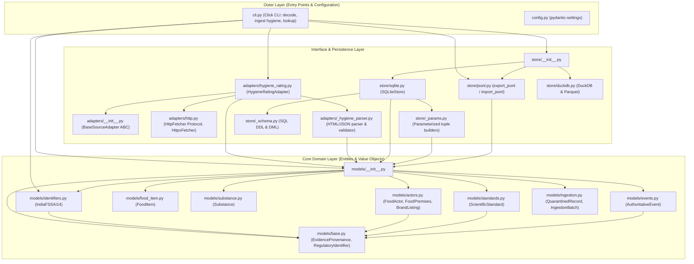

# india-ate Architecture

## Overview

`india-ate` follows **Clean Architecture** (inward-only dependencies) and **SOLID** design principles. Core domain entities, deterministic identifiers, and ingestion/quarantine value objects in `src/india_ate/models/` have zero dependencies on persistence drivers, HTTP clients, HTML parsers, configuration loaders, or CLI frameworks.

## Layer Diagram



External runtime dependencies remain strictly confined to their appropriate layers:
- **Core (`models/`)**: Python stdlib + `pydantic` (`BaseModel`, `ConfigDict`, `Field`, `HttpUrl`, `model_validator`).
- **Adapters (`adapters/`)**: Python stdlib + `pydantic` + `httpx` (`adapters/http.py`) + `beautifulsoup4` (`adapters/_hygiene_parser.py`).
- **Persistence (`store/`)**: Python stdlib (`sqlite3`, `json`, `pathlib`) + `pydantic` + `duckdb`.
- **Outer (`cli.py`, `config.py`)**: `click`, `pydantic-settings`.

## Dependency Verification Results

All boundary verification `grep` commands were executed against `src/india_ate/` and returned empty output (`exit=1`, zero matches), confirming zero outward or cross-layer violations:

```bash
$ grep -rn "from india_ate.store" src/india_ate/models/
exit=1 stdout=''

$ grep -rn "from india_ate.adapters" src/india_ate/models/
exit=1 stdout=''

$ grep -rn "from india_ate.cli" src/india_ate/models/
exit=1 stdout=''

$ grep -rn "from india_ate.config" src/india_ate/models/
exit=1 stdout=''

$ grep -rn "import click" src/india_ate/models/
exit=1 stdout=''

$ grep -rn "import sqlite3" src/india_ate/models/
exit=1 stdout=''

$ grep -rn "import duckdb" src/india_ate/models/
exit=1 stdout=''

$ grep -rn "import httpx" src/india_ate/models/
exit=1 stdout=''

$ grep -rn "import bs4\|from bs4" src/india_ate/models/
exit=1 stdout=''

$ grep -rn "import logfire" src/india_ate/models/
exit=1 stdout=''

$ grep -rn "from india_ate.cli" src/india_ate/store/
exit=1 stdout=''

$ grep -rn "from india_ate.adapters" src/india_ate/store/
exit=1 stdout=''

$ grep -rn "from india_ate.config" src/india_ate/store/
exit=1 stdout=''

$ grep -rn "from india_ate.store" src/india_ate/adapters/
exit=1 stdout=''

$ grep -rn "from india_ate.cli" src/india_ate/adapters/
exit=1 stdout=''

$ grep -rn "from india_ate.config" src/india_ate/adapters/
exit=1 stdout=''

$ grep -rn "from india_ate\." src/india_ate/config.py
exit=1 stdout=''
```

## Component Responsibilities

Each of the 22 modules in `src/india_ate/` has one clear responsibility and strict non-responsibilities:

| Module | Owns (Single Responsibility) | Must Not Do |
|---|---|---|
| `src/india_ate/__init__.py` | Exposes package docstring and `__version__`. | Import models, stores, adapters, or trigger side effects. |
| `src/india_ate/models/__init__.py` | Re-exports canonical domain models and type aliases as the public `india_ate.models` surface. | Contain business logic, persistence code, or adapter/CLI imports. |
| `src/india_ate/models/base.py` | Defines `EvidenceProvenance`, `VerificationTier`, and polymorphic `RegulatoryIdentifier` with dynamic subclass dispatch (`__subclasses__()`). | Import concrete identifier subclasses, storage engines, or network/CLI libraries. |
| `src/india_ate/models/identifiers.py` | Implements deterministic offline decoding for Indian 14-digit FSSAI IDs (`IndiaFSSAI14`, `STATE_UT_CODES`, `CENTRAL_RO_DO_CODES`). | Perform network calls, CLI I/O, or database queries. |
| `src/india_ate/models/actors.py` | Defines `FoodActor`, `FoodPremises` (LSP subtype), `BrandListing`, and `group_brand_listings_by_premises`. | Execute SQL joins or import persistence/adapter layers. |
| `src/india_ate/models/food_item.py` | Defines `FoodItem` and `ItemKind` linked to FoodOn, IFCT 2017, GTIN, and supply-chain entity IDs. | Query external ontology APIs or persist records directly. |
| `src/india_ate/models/substance.py` | Defines `Substance` and `SubstanceClass` keyed by CAS number, PubChem CID, and INS/E-number. | Fetch toxicology data or depend on storage layers. |
| `src/india_ate/models/standards.py` | Defines `ScientificStandard` and `StandardType` anchored to `EvidenceProvenance`. | Evaluate or mutate scientific limits dynamically or access databases. |
| `src/india_ate/models/events.py` | Defines `AuthoritativeEvent` and `EventType` for strictly factual enforcement, recall, audit, lab, and grievance records. | Infer, synthesize, or alter enforcement statuses or depend on outer layers. |
| `src/india_ate/models/ingestion.py` | Defines `QuarantinedRecord` and `IngestionBatch` for deterministic adapter validation and quarantine output. | Import adapters, stores, HTTP clients, or CLI frameworks. |
| `src/india_ate/adapters/__init__.py` | Defines the minimal `BaseSourceAdapter` ABC (`fetch`, `parse`, `validate_and_emit`) under ISP. | Depend on concrete stores, CLI frameworks, or source-specific crawler implementations. |
| `src/india_ate/adapters/http.py` | Defines the `HttpFetcher` `Protocol` port (DIP) and `HttpxFetcher` concrete `httpx.Client` implementation. | Import domain models, stores, or CLI modules, or parse source payloads. |
| `src/india_ate/adapters/hygiene_rating.py` | Implements `HygieneRatingAdapter` using injected `HttpFetcher`, emitting `FoodPremises` + `AuthoritativeEvent` or `QuarantinedRecord` via `IngestionBatch`. | Import `store/` or `cli.py`, or fabricate missing regulatory fields. |
| `src/india_ate/adapters/_hygiene_parser.py` | Parses HTML (`BeautifulSoup`) and JSON snapshot bytes into candidate rows and validates mandatory hygiene fields. | Perform network calls, persist records, or import `store/` or `cli.py`. |
| `src/india_ate/store/__init__.py` | Re-exports public persistence and analytics interfaces (`SQLiteStore`, `GhostBrandCluster`, JSONL, DuckDB/Parquet helpers). | Contain SQL statements, CLI logic, or adapter code. |
| `src/india_ate/store/_schema.py` | Centralizes SQLite DDL (`SCHEMA_SQL`, including `quarantined_records`) and parameterized `INSERT` statements. | Open database connections or import domain models/CLI/adapters. |
| `src/india_ate/store/_params.py` | Builds parameterized SQLite tuple payloads (`premises_params`, `brand_listing_params`, `event_params`, `quarantined_params`). | Execute SQL queries or import `sqlite3`, `adapters/`, or `cli.py`. |
| `src/india_ate/store/sqlite.py` | Implements parameterized `sqlite3` persistence (`SQLiteStore`, `save_ingestion_batch`, `save_quarantined_record`, `get_quarantined_records`, `GhostBrandCluster`). | Import `cli.py`, `adapters/`, or `duckdb`, or construct unparameterized SQL strings. |
| `src/india_ate/store/jsonl.py` | Implements UTF-8 open-data `export_jsonl` and `import_jsonl` round-trips across all 7 canonical entity models via `ENTITY_REGISTRY`. | Depend on `sqlite3`, `duckdb`, `adapters/`, or `cli.py`. |
| `src/india_ate/store/duckdb.py` | Exports SQLite tables to Parquet via DuckDB (`write_parquet_table`, `export_parquet_snapshots`) and runs read-only analytical Parquet queries. | Mutate runtime OLTP state or import `cli.py`, `adapters/`, or `config.py`. |
| `src/india_ate/config.py` | Loads typed runtime configuration (`Settings` via `pydantic-settings` with `INDIA_ATE_` env prefix). | Import domain models, stores, adapters, or execute I/O at import time. |
| `src/india_ate/cli.py` | Provides the `click` CLI entry point (`app`, `decode`, `ingest hygiene`, `lookup` Fact Receipt) wiring adapters and stores. | Embed domain decoding rules, HTML parsing, or direct SQL queries. |

## SOLID & Architectural Notes

- **Single Responsibility (SRP)**: Domain entities, FSSAI offline decoding, ingestion/quarantine value objects, HTTP transport (`adapters/http.py`), HTML/JSON parsing (`adapters/_hygiene_parser.py`), adapter orchestration (`adapters/hygiene_rating.py`), SQL schema (`store/_schema.py`), tuple builders (`store/_params.py`), SQLite CRUD (`store/sqlite.py`), JSONL serialization (`store/jsonl.py`), DuckDB Parquet analytics (`store/duckdb.py`), config, and CLI live in separate, focused modules (all modules `<= 173` lines).
- **Open/Closed (OCP)**: `RegulatoryIdentifier` in `models/base.py` never imports `IndiaFSSAI14`; its `_dispatch_subclass_from_json` validator inspects `cls.__subclasses__()` dynamically. New adapters subclass `BaseSourceAdapter` without modifying `models/` or `store/`.
- **Liskov Substitution (LSP)**: `FoodPremises(FoodActor)` adds optional location/premises metadata without weakening invariants or changing base field semantics; `IndiaFSSAI14(RegulatoryIdentifier)` satisfies `decode_offline() -> dict[str, Any]`; `HygieneRatingAdapter` satisfies `BaseSourceAdapter`.
- **Interface Segregation (ISP)**: `BaseSourceAdapter` defines only `fetch()`, `parse()`, and `validate_and_emit()`; `HttpFetcher` defines only `get()` and `post()`.
- **Dependency Inversion (DIP)**: `models/` depends on zero outer modules. `HygieneRatingAdapter` depends on the `HttpFetcher` `Protocol` abstraction rather than concrete `httpx` transport, enabling deterministic offline testing. `cli.py` wires concrete adapters and stores at the outer composition root.
- **Structural Caveat for Future Phases**: `store/duckdb.py` mirrors table/column specs (`_TABLE_SPECS`) from `store/_schema.py` when reading SQLite tables directly, and `store/jsonl.py` maintains an explicit `ENTITY_REGISTRY` mapping for the 7 canonical entity classes. When adding new entity models or columns, update `store/_schema.py`, `store/_params.py`, `store/duckdb.py`, and `store/jsonl.py` in lockstep (all within `store/`, keeping `models/` untouched).

## Extension Points

### 1. Adding a New `RegulatoryIdentifier` Scheme (OCP & LSP)

1. Create or update a module under `src/india_ate/models/` (e.g., `models/identifiers.py` or a new country module) and subclass `RegulatoryIdentifier`:
   ```python
   from typing import Any, Literal
   from india_ate.models.base import RegulatoryIdentifier


   class USFDAFEI(RegulatoryIdentifier):
       jurisdiction_iso: Literal["US"] = "US"
       scheme: Literal["US_FDA_FEI"] = "US_FDA_FEI"

       def decode_offline(self) -> dict[str, Any]:
           ...
   ```
2. Export the new subclass from `src/india_ate/models/__init__.py` so it is imported whenever `india_ate.models` is loaded.
3. Because `RegulatoryIdentifier._find_subclass_for_scheme` scans `cls.__subclasses__()` by matching `scheme` default values, JSON deserialization on `FoodActor` / `FoodPremises` automatically reconstructs the concrete subclass without editing `models/base.py`.

### 2. Adding a New `BaseSourceAdapter` Implementation (OCP, ISP & DIP)

1. Create a concrete adapter module under `src/india_ate/adapters/` (e.g., `src/india_ate/adapters/foscos.py`) subclassing `BaseSourceAdapter`.
2. Inject `HttpFetcher` in `__init__` (defaulting to `HttpxFetcher()`) so tests can supply an offline stub without network I/O.
3. Implement the contract methods:
   - `fetch() -> bytes`: retrieve raw official bytes via `HttpFetcher`.
   - `parse(raw: bytes) -> list[dict[str, Any]]`: extract structured candidate dicts without guessing missing values.
   - `validate_and_emit(records: list[dict[str, Any]]) -> list[BaseModel]` (and optionally `validate_and_emit_batch(...) -> IngestionBatch`): construct validated `india_ate.models` instances anchored with `EvidenceProvenance` (`source_url` + `content_sha256`), routing invalid or ambiguous rows to `QuarantinedRecord` rather than fabricating fields.
4. Keep the adapter free of `store/` and `cli.py` imports; wire adapter output to stores in `cli.py`.

### 3. Adding a New Persistence or Analytics Store (OCP & DIP)

1. Add a new module under `src/india_ate/store/` that imports only from `india_ate.models` and its own database/file driver.
2. Do not import the new store from `models/` or `adapters/`.
3. Wire concrete `store/` implementations in `cli.py` so inner layers continue to depend only on abstractions.
