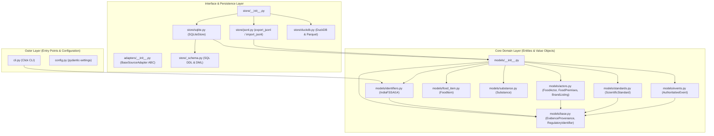

# india-ate Architecture

## Overview

`india-ate` follows **Clean Architecture** (inward-only dependencies) and **SOLID** design principles. Core domain entities and deterministic identifiers in `src/india_ate/models/` have zero dependencies on persistence drivers, ingestion adapters, configuration loaders, or CLI frameworks.

## Layer Diagram



External runtime dependencies remain strictly confined to their appropriate layers:
- **Core (`models/`)**: Python stdlib + `pydantic` (`BaseModel`, `ConfigDict`, `Field`, `HttpUrl`, `model_validator`).
- **Adapters (`adapters/`)**: Python stdlib (`abc`, `typing`) + `pydantic.BaseModel`.
- **Persistence (`store/`)**: Python stdlib (`sqlite3`, `json`, `pathlib`) + `pydantic` + `duckdb`.
- **Outer (`cli.py`, `config.py`)**: `click`, `pydantic-settings`.

## Dependency Verification Results

All boundary verification `grep` commands were executed against `src/india_ate/` and returned empty output (`exit=1`, zero matches), confirming zero outward or cross-layer violations:

```bash
$ grep -rn "from india_ate.store" src/india_ate/models/
exit=1 stdout=''

$ grep -rn "from india_ate.adapters" src/india_ate/models/
exit=1 stdout=''

$ grep -rn "from india_ate.cli" src/india_ate/models/
exit=1 stdout=''

$ grep -rn "from india_ate.config" src/india_ate/models/
exit=1 stdout=''

$ grep -rn "import click" src/india_ate/models/
exit=1 stdout=''

$ grep -rn "import sqlite3" src/india_ate/models/
exit=1 stdout=''

$ grep -rn "import duckdb" src/india_ate/models/
exit=1 stdout=''

$ grep -rn "import logfire" src/india_ate/models/
exit=1 stdout=''

$ grep -rn "from india_ate.cli" src/india_ate/store/
exit=1 stdout=''

$ grep -rn "from india_ate.adapters" src/india_ate/store/
exit=1 stdout=''

$ grep -rn "from india_ate.config" src/india_ate/store/
exit=1 stdout=''

$ grep -rn "from india_ate.store" src/india_ate/adapters/
exit=1 stdout=''

$ grep -rn "from india_ate.cli" src/india_ate/adapters/
exit=1 stdout=''

$ grep -rn "from india_ate.config" src/india_ate/adapters/
exit=1 stdout=''

$ grep -rn "from india_ate\." src/india_ate/config.py
exit=1 stdout=''
```

## Component Responsibilities

Each module in `src/india_ate/` has one clear responsibility and strict non-responsibilities:

| Module | Owns (Single Responsibility) | Must Not Do |
|---|---|---|
| `src/india_ate/__init__.py` | Exposes package docstring and `__version__`. | Import models, stores, adapters, or trigger side effects. |
| `src/india_ate/models/__init__.py` | Re-exports canonical domain models and type aliases as the public `india_ate.models` surface. | Contain business logic, persistence code, or adapter/CLI imports. |
| `src/india_ate/models/base.py` | Defines `EvidenceProvenance`, `VerificationTier`, and polymorphic `RegulatoryIdentifier` with dynamic subclass dispatch (`__subclasses__()`). | Import concrete identifier subclasses, storage engines, or network/CLI libraries. |
| `src/india_ate/models/identifiers.py` | Implements deterministic offline decoding for Indian 14-digit FSSAI IDs (`IndiaFSSAI14`, `STATE_UT_CODES`, `CENTRAL_RO_DO_CODES`). | Perform network calls, CLI I/O, or database queries. |
| `src/india_ate/models/actors.py` | Defines `FoodActor`, `FoodPremises` (LSP subtype), `BrandListing`, and `group_brand_listings_by_premises`. | Execute SQL joins or import persistence/adapter layers. |
| `src/india_ate/models/food_item.py` | Defines `FoodItem` and `ItemKind` linked to FoodOn, IFCT 2017, GTIN, and supply-chain entity IDs. | Query external ontology APIs or persist records directly. |
| `src/india_ate/models/substance.py` | Defines `Substance` and `SubstanceClass` keyed by CAS number, PubChem CID, and INS/E-number. | Fetch toxicology data or depend on storage layers. |
| `src/india_ate/models/standards.py` | Defines `ScientificStandard` and `StandardType` anchored to `EvidenceProvenance`. | Evaluate or mutate scientific limits dynamically or access databases. |
| `src/india_ate/models/events.py` | Defines `AuthoritativeEvent` and `EventType` for strictly factual enforcement, recall, audit, lab, and grievance records. | Infer, synthesize, or alter enforcement statuses or depend on outer layers. |
| `src/india_ate/adapters/__init__.py` | Defines the minimal `BaseSourceAdapter` ABC (`fetch`, `parse`, `validate_and_emit`) under ISP. | Depend on concrete stores, CLI frameworks, or source-specific crawler implementations. |
| `src/india_ate/store/__init__.py` | Re-exports public persistence and analytics interfaces (`SQLiteStore`, `GhostBrandCluster`, JSONL, DuckDB/Parquet helpers). | Contain SQL statements, CLI logic, or adapter code. |
| `src/india_ate/store/_schema.py` | Centralizes SQLite DDL (`SCHEMA_SQL`) and parameterized `INSERT OR REPLACE` statements. | Open database connections or import domain models/CLI. |
| `src/india_ate/store/sqlite.py` | Implements parameterized `sqlite3` persistence (`SQLiteStore`) and `GhostBrandCluster` queries for `FoodPremises`, `BrandListing`, and `AuthoritativeEvent`. | Import `cli.py`, `adapters/`, or `duckdb`, or construct unparameterized SQL strings. |
| `src/india_ate/store/jsonl.py` | Implements UTF-8 open-data `export_jsonl` and `import_jsonl` round-trips across all 7 canonical entity models via `ENTITY_REGISTRY`. | Depend on `sqlite3`, `duckdb`, `adapters/`, or `cli.py`. |
| `src/india_ate/store/duckdb.py` | Exports SQLite tables to Parquet via DuckDB (`write_parquet_table`, `export_parquet_snapshots`) and runs read-only analytical Parquet queries. | Mutate runtime OLTP state or import `cli.py`, `adapters/`, or `config.py`. |
| `src/india_ate/config.py` | Loads typed runtime configuration (`Settings` via `pydantic-settings` with `INDIA_ATE_` env prefix). | Import domain models, stores, adapters, or execute I/O at import time. |
| `src/india_ate/cli.py` | Provides the `click` CLI entry point (`app`, `decode` command) translating domain `ValueError`s into `click.ClickException`. | Embed domain decoding rules or direct SQL queries. |

## SOLID & Architectural Notes

- **Single Responsibility (SRP)**: Domain entities, FSSAI offline decoding, SQL schema constants, SQLite CRUD, JSONL serialization, DuckDB Parquet analytics, config, and CLI live in separate, focused modules (each `<= 173` lines, all functions `<= 20` lines, max Radon CC = `5`).
- **Open/Closed (OCP)**: `RegulatoryIdentifier` in `models/base.py` never imports `IndiaFSSAI14`; its `_dispatch_subclass_from_json` validator inspects `cls.__subclasses__()` dynamically.
- **Liskov Substitution (LSP)**: `FoodPremises(FoodActor)` adds optional location/premises metadata without weakening invariants or changing base field semantics; `IndiaFSSAI14(RegulatoryIdentifier)` satisfies `decode_offline() -> dict[str, Any]`.
- **Interface Segregation (ISP)**: `BaseSourceAdapter` defines only `fetch()`, `parse()`, and `validate_and_emit()`.
- **Dependency Inversion (DIP)**: `models/` depends on zero outer modules. Outer modules (`store/`, `cli.py`) depend inward on `models/`.
- **Structural Caveat for Future Phases**: `store/duckdb.py` mirrors table/column specs (`_TABLE_SPECS`) from `store/_schema.py` when reading SQLite tables directly, and `store/jsonl.py` maintains an explicit `ENTITY_REGISTRY` mapping for the 7 canonical entity classes. When adding new entity models or columns, update `store/_schema.py`, `store/duckdb.py`, and `store/jsonl.py` in lockstep (all within `store/`, keeping `models/` untouched).

## Extension Points

### 1. Adding a New `RegulatoryIdentifier` Scheme (OCP & LSP)

1. Create or update a module under `src/india_ate/models/` (e.g., `models/identifiers.py` or a new country module) and subclass `RegulatoryIdentifier`:
   ```python
   from typing import Any, Literal
   from india_ate.models.base import RegulatoryIdentifier


   class USFDAFEI(RegulatoryIdentifier):
       jurisdiction_iso: Literal["US"] = "US"
       scheme: Literal["US_FDA_FEI"] = "US_FDA_FEI"

       def decode_offline(self) -> dict[str, Any]:
           ...
   ```
2. Export the new subclass from `src/india_ate/models/__init__.py` so it is imported whenever `india_ate.models` is loaded.
3. Because `RegulatoryIdentifier._find_subclass_for_scheme` scans `cls.__subclasses__()` by matching `scheme` default values, JSON deserialization on `FoodActor` / `FoodPremises` automatically reconstructs the concrete subclass without editing `models/base.py`.

### 2. Adding a New `BaseSourceAdapter` Implementation (OCP, ISP & DIP)

1. Create a concrete adapter module under `src/india_ate/adapters/` (e.g., `src/india_ate/adapters/foscos.py`) subclassing `BaseSourceAdapter`.
2. Implement the three contract methods:
   - `fetch() -> bytes`: retrieve raw official bytes (or fixture bytes in tests).
   - `parse(raw: bytes) -> list[dict[str, Any]]`: extract structured candidate dicts without guessing missing values.
   - `validate_and_emit(records: list[dict[str, Any]]) -> list[BaseModel]`: construct validated `india_ate.models` instances anchored with `EvidenceProvenance` (`source_url` + `content_sha256`), quarantining ambiguous records rather than fabricating fields.
3. Keep the adapter free of `store/` and `cli.py` imports; wire adapter output to stores at the CLI/orchestration boundary.

### 3. Adding a New Persistence or Analytics Store (OCP & DIP)

1. Add a new module under `src/india_ate/store/` (e.g., `src/india_ate/store/postgres.py` or a repository implementation) that imports only from `india_ate.models` and its own database/file driver.
2. Do not import the new store from `models/` or `adapters/`.
3. When Phase 2 adds multi-store CLI ingestion pipelines, define an abstract `Protocol` or `ABC` port in an application/use-case module (or `models/ports.py`) and inject concrete `store/` implementations from `cli.py` so inner layers continue to depend only on abstractions.
