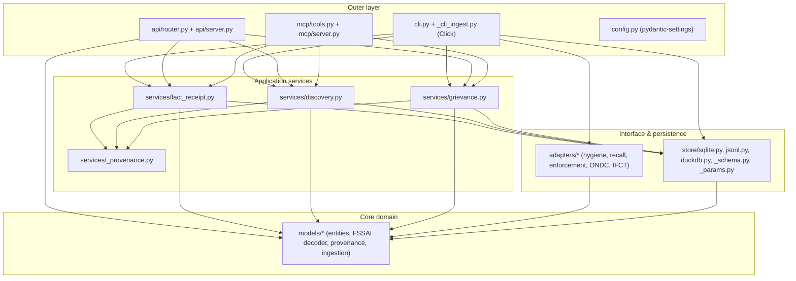

# india-ate Architecture

## Overview

`india-ate` follows **Clean Architecture** (inward-only dependencies) and SOLID
design principles. The domain layer in `src/india_ate/models/` depends only on
the Python standard library and Pydantic. Persistence, HTTP, parsing, CLI,
configuration, API, and MCP concerns live in outer layers.

```text
Entry points (CLI, REST, MCP, static web)
        ↓
Services (Fact Receipt, discovery, grievance)
        ↓
Stores / adapters (SQLite, JSONL, DuckDB, source adapters)
        ↓
Domain models (entities, identifiers, provenance, ingestion value objects)
```

## Layer diagram



## Runtime dependencies by layer

| Layer | Allowed runtime dependencies |
| --- | --- |
| `models/` | stdlib + `pydantic` only |
| `services/` | stdlib + `pydantic` + `models/` + `SQLiteStore` application boundary |
| `adapters/` | stdlib + `pydantic` + `httpx` + `beautifulsoup4` + `models/` |
| `store/` | stdlib (`sqlite3`, `json`, `pathlib`) + `pydantic` + `duckdb` + `models/` |
| `api/`, `mcp/`, `cli.py`, `config.py` | outer-layer frameworks and the services above |
| `web/` | Astro/TypeScript; consumes the REST API or synthetic fixtures |

## Component responsibilities

| Area | Responsibility |
| --- | --- |
| `models/base.py` | `EvidenceProvenance`, verification tiers, polymorphic `RegulatoryIdentifier` |
| `models/identifiers.py` | Deterministic 14-digit FSSAI decode (offline) |
| `models/actors.py`, `food_item.py`, `substance.py`, `standards.py` | Canonical entity graph models |
| `models/events.py`, `ingestion.py` | Authoritative events, quarantine, ingestion batches |
| `adapters/*` | Fetch/parse/validate official sources; quarantine rather than guess |
| `store/sqlite.py` | Parameterized OLTP persistence and ghost-brand joins |
| `store/jsonl.py`, `duckdb.py` | Git-versioned exports and Parquet analytics |
| `services/fact_receipt.py` | Source-backed Fact Receipt assembly |
| `services/_provenance.py` | Official-vs-user provenance classification |
| `services/discovery.py` | Nearby-switch eligibility |
| `services/grievance.py` | 15-day escalation packet generation |
| `api/router.py`, `api/server.py` | Stdlib JSON REST surface, CORS, request limits |
| `mcp/tools.py`, `mcp/server.py` | JSON-RPC 2.0 MCP tool server over stdio |
| `cli.py`, `_cli_ingest.py` | Click entry point and ingestion commands |
| `web/` | Static demo UI; synthetic data is explicitly labelled |

## Dependency verification

These commands must return no matches:

```bash
grep -rn "from india_ate.store\|from india_ate.adapters\|from india_ate.cli\|from india_ate.config" src/india_ate/models/
grep -rnE "import (sqlite3|duckdb|click|httpx|bs4|logfire)|from (sqlite3|duckdb|click|httpx|bs4|logfire)" src/india_ate/models/
grep -rn "from india_ate.cli\|from india_ate.config" src/india_ate/store/ src/india_ate/adapters/
```

Current status: **zero violations**. `models/` imports only stdlib and
Pydantic, including no outward imports from services, stores, adapters, API, or
CLI layers.

## Data-integrity boundary

The application layer is where provenance policy is enforced:

- `services/_provenance.py` classifies events as official only for
  `official_registry` and `peer_reviewed_science`.
- `services/fact_receipt.py` filters events and computes `last_verified_at` from
  official provenance only.
- `services/discovery.py` ignores user-submitted events when deciding nearby
  eligibility.
- `services/grievance.py` counts only official events and persists user tickets
  with `user_verified_snapshot` when explicitly enabled.
- The HTTP API defaults to non-persisting grievance packets; the CLI is the
  explicit local persistence path.

## Extension points

### Add a source adapter

1. Subclass `BaseSourceAdapter` in `adapters/`.
2. Inject an `HttpFetcher` for testability.
3. Emit `IngestionBatch` with validated models and `QuarantinedRecord` entries.
4. Wire the adapter into `_cli_ingest.py`.

### Add a regulatory identifier scheme

1. Subclass `RegulatoryIdentifier` with a new `scheme` and `decode_offline()`.
2. Export it from `models/__init__.py`.
3. JSON deserialization resolves the subclass dynamically; `models/base.py` does
   not need modification.

### Add a store

1. Implement the store in `store/` using only `models/` and its driver.
2. Do not import stores from `models/` or `adapters/`.
3. Wire the concrete store in the outer composition root (`cli.py` or an API
   entry point).

## Module size and complexity

All Python modules are ≤200 lines. Current largest modules are
`_cli_ingest.py` (183), `store/duckdb.py` (173), `store/sqlite.py` (171), and
`cli.py` (168). `radon cc src/ -a -nb` reports average complexity **A (2.0)**
with no grade C or higher.
